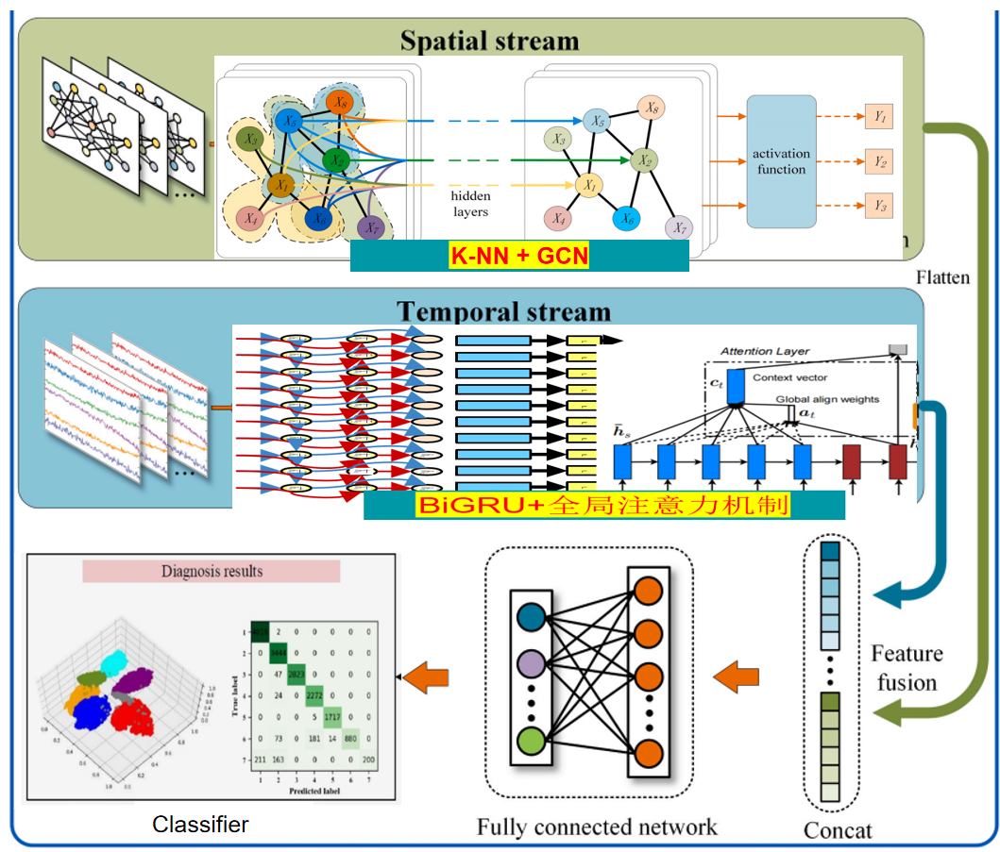
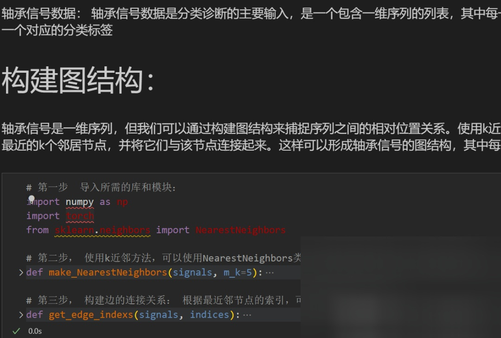
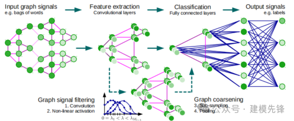
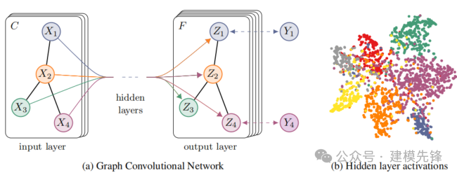
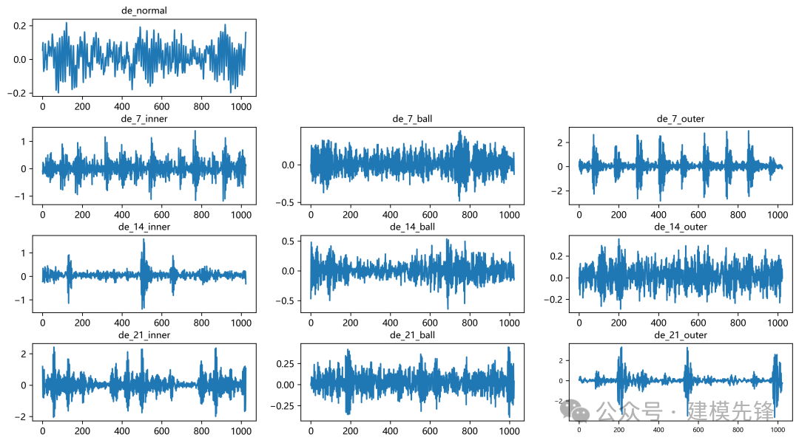
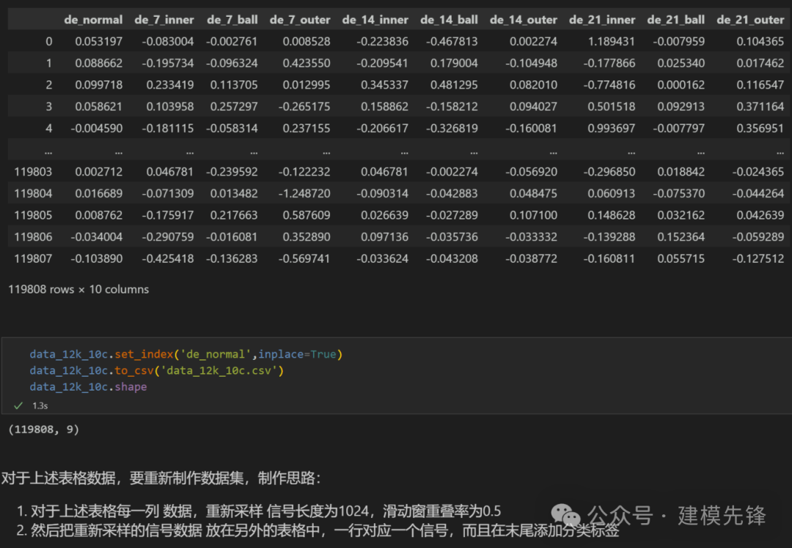
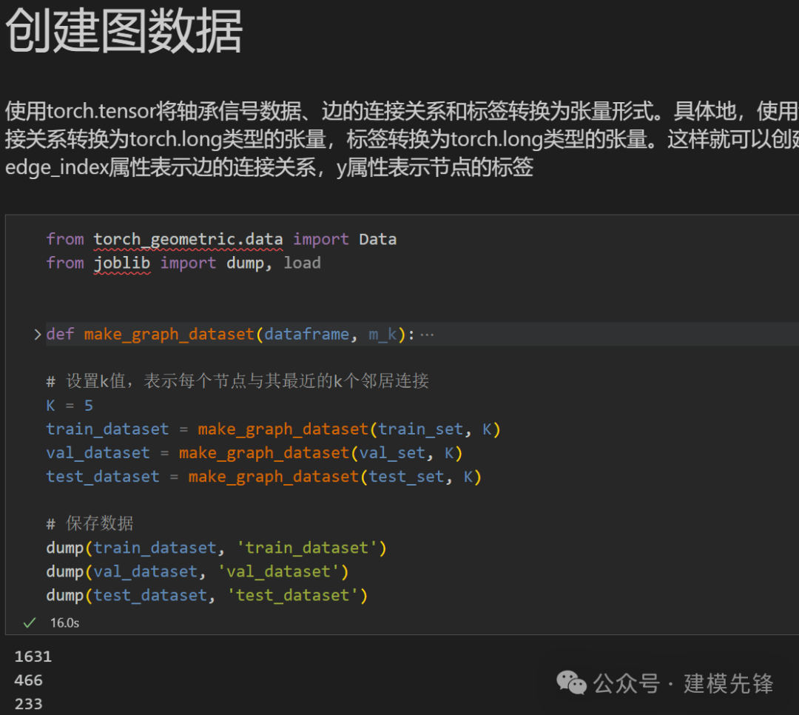

# Diagnostics for Fault Isolation directly written, Convolutional + BiGRU-Attention Parallel Diagnostic Model

Preface  
This issue introduces a parallel classification model based on K-NN + GCN and an optimized BiGRU with Global Attention mechanism, which shows significant performance in fault diagnosis tasks!
1. Model Introduction and Innovation Points  
1.1 Model Introduction  
In the application of Graph Convolutional Networks (GCN) to signal pattern recognition, the key lies in how to construct the graph structure of data; we utilize a method for preprocessing bearing fault signals based on K-NN to build the graph structure of the fault signal sequence, and diagnose and identify using the GCN+BiGRU-GlobalAttention network model, achieving certain accuracy in classification.  
●Dataset: CWRU West China University bearing dataset  
●Environment framework: Python 3.9, PyTorch 1.8 or above versions can run  
●Accuracy: Test set 99%  
●Usage: Paper requirements, graduation design requirements  
●Code guarantee: Code comments are detailed, ready to run without modification.  
Note: We also have accompanying model explanations (for learning network structures) and parameter tuning explanations! For those who need a graduation project or a small paper, this is essential, with rich modules and high innovation, excellent performance!!  
1.2 Innovation Points Introduction  
The innovative model based on KNN-GCN+BiGRU-GATT  
\n        \n  
High innovation, noticeable results!! Innovation point:  
Innovation one: Using K-NN to create a fault signal graph structure  
Bearing signals are one-dimensional sequences, we can capture the relative positional relationship between sequences by constructing a graph structure. Use k-nearest neighbor methods to establish edge connections between nodes. For each node, find its nearest k neighbors and connect them to the node. This can form a graph structure of bearing signals, where each node corresponds to a data point, and the edges represent the connection relationships between nodes;
Innovation 2: Utilizing GCN Networks for Fault Diagnosis
(1) Handling Graph-Structured Data: The preprocessed bearing signal can be considered as a complex graph structure, where nodes represent different sequence positions and edges represent their associations. GCN networks are deep learning models specifically designed for processing graph-structured data, which can fully utilize the topological structure information of nodes and edges, helping to mine the complex associations and patterns in fault signals.
(2) Capturing Local and Spatial Information: Through the stacking of multiple graph convolutional layers, GCN networks can gradually aggregate local neighbor information of nodes and ultimately obtain node representations that contain global information. In the field of bearing fault diagnosis, this capability enables GCN networks to simultaneously capture local vibration characteristics and overall spatial system states, thereby improving the accuracy of fault diagnosis and prediction.
(3) Automated Learning of Feature Representations: GCN networks can automatically learn node feature representations without the need for manual feature engineering. In the field of bearing fault diagnosis, this means that GCN networks can extract key features from raw vibration data, identifying fault patterns.
Innovation 3: Proposing a BiGRU network model based on GlobalAttention optimization to extract global temporal feature of fault signals;
Innovation 4: By merging two branches through parallel models to extract local spatial features and global temporal features, the ability to improve feature representation is achieved to achieve fault signal recognition, achieving excellent results!
2 Preprocessing of Bearing Fault Data
\t2.1 Importing Data
\tRefer to previous articles for preprocessing of fault classification, using the Case Western Reserve University bearing data set for fault classification:
\ttrain_set, val_set, test_set are divided into training set, validation set, and test set in a ratio of 7:2:1, and finally save the data.
\tThe above figure shows the reading form of the data and the preprocessing idea.
\t2.2 Data Preprocessing, Making the Dataset
3 Bearing Fault Diagnosis Based on KNN-GCN+BiGRU-GATT
3.1 Define the KNN-GCN+BiGRU-GATT Classification Network Model
3.2 Set parameters and train the model
50 epochs, accuracy of 99%, the KNN-GCN+BiGRU-GATT network classification effect is significant. The model can fully extract the spatial and temporal features of bearing fault signals, converges quickly, has excellent performance, high accuracy, and noticeable effects!
3.3 Model Evaluation
Accuracy, Precision, Recall, F1 Score
Fault-classification confusion matrix:
Other visualizations:
(1) Original data t-SNE feature visualization
(2) T-SNE feature visualization after model training:
Click to download: Complete original data, Python code

## Images

<!-- PAYMENT_BLOCK -->

## Get this dataset

- Payment link (Stripe): [Buy now](https://buy.stripe.com/3cs8yP7sY87d0vu9AB)
- Payment QR code: 

<!-- /PAYMENT_BLOCK -->
